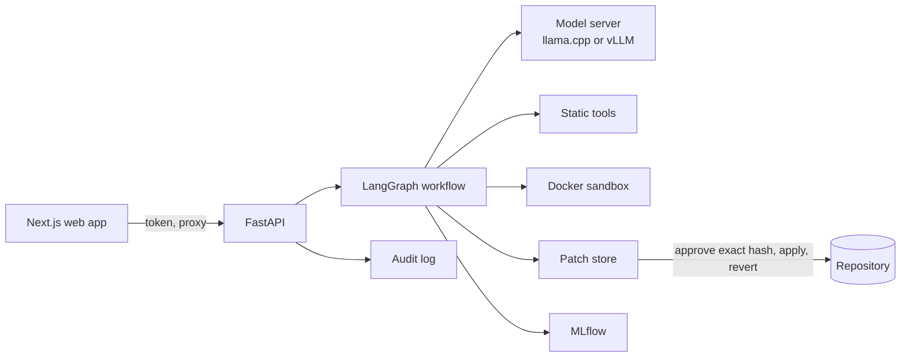
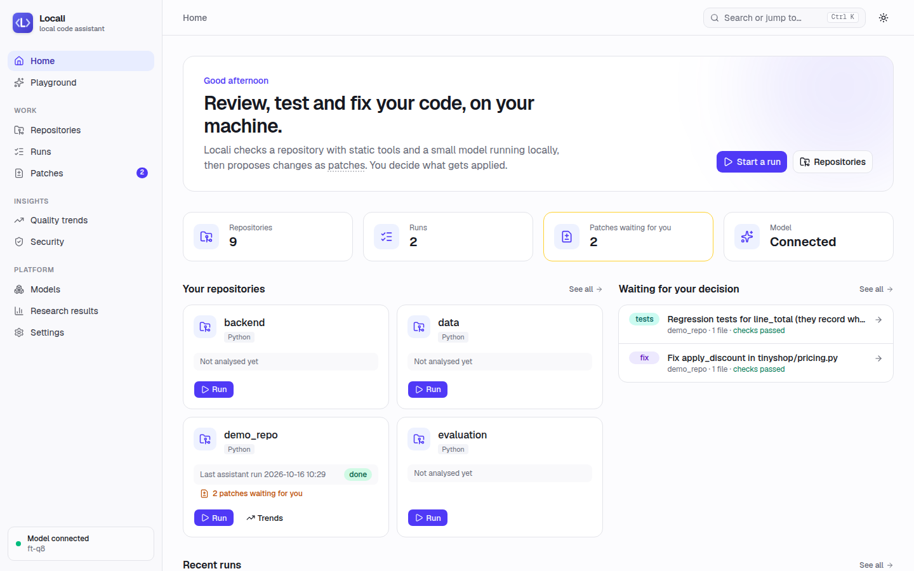
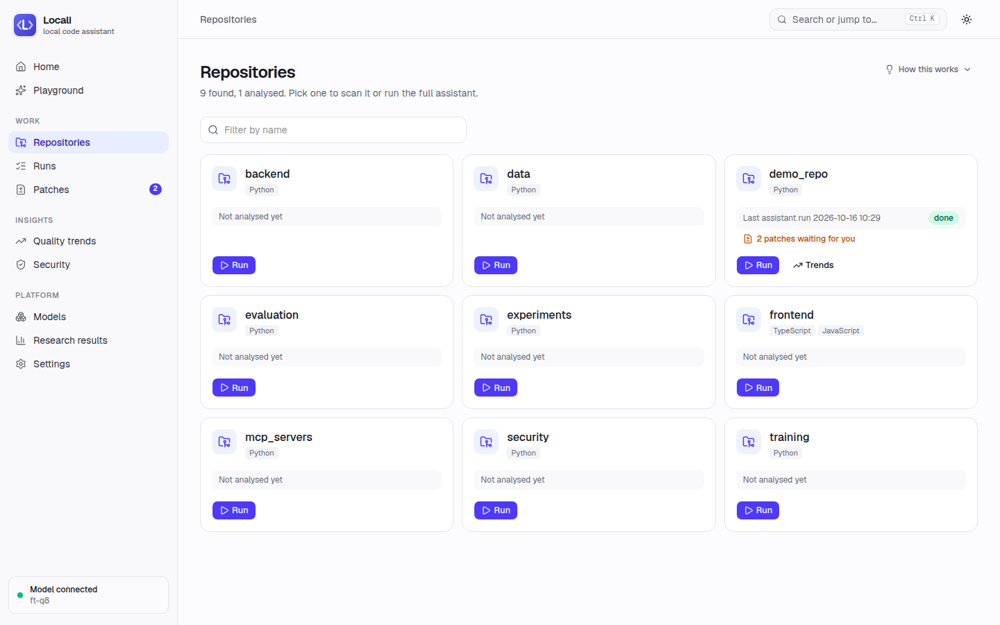
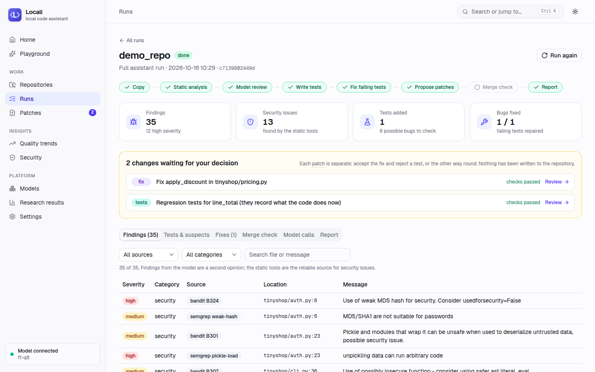
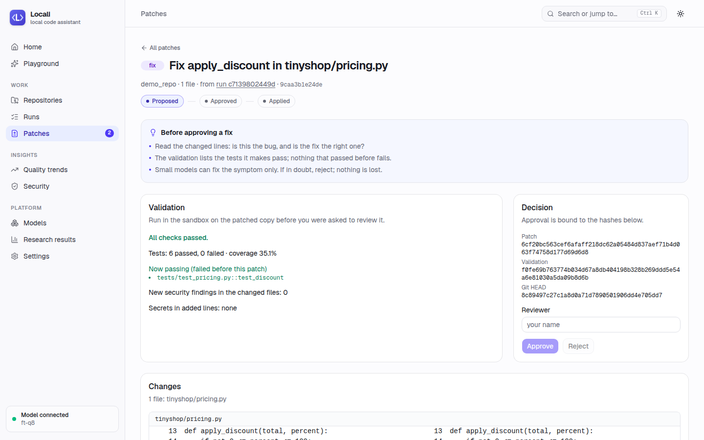
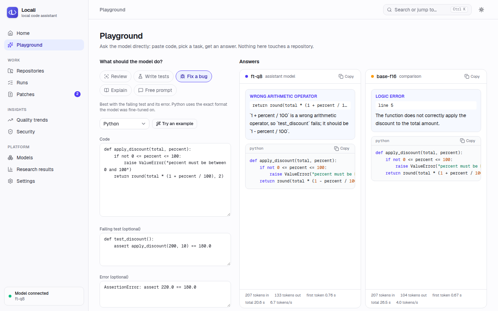
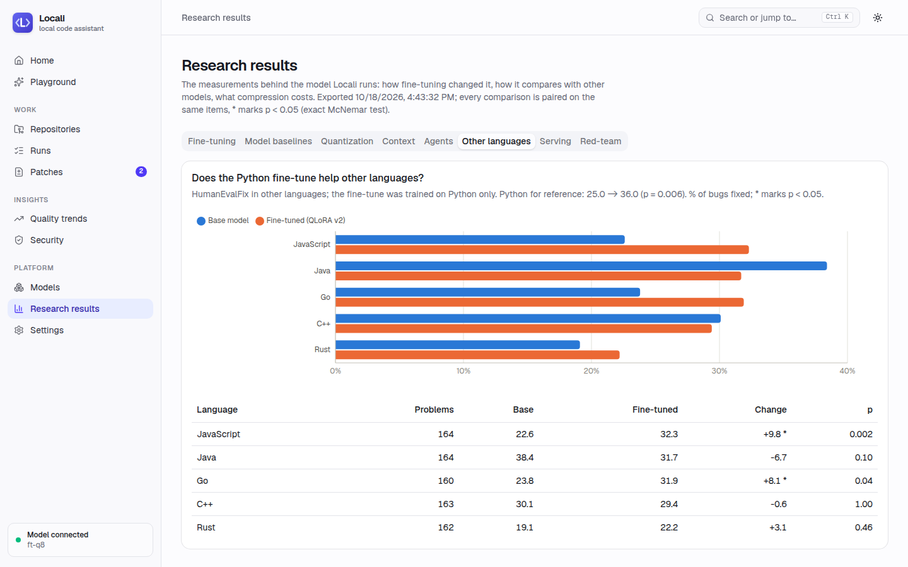

# Locali

A software-engineering assistant built on a 1.5-billion-parameter model that runs on a laptop CPU:
it reviews a repository, writes tests, fixes failing ones, documents functions and checks merge
readiness, and every change it proposes waits for a human to approve that exact patch.

Course project *Efficient Small Language Models for Intelligent Software Engineering, Testing and
DevOps* (2026). The brief was written for teams of five; I did it alone, with the hardware I have
(a 4-core laptop without a GPU, 16 GB RAM) and Kaggle's free T4 GPUs.

> **Research question.** Can small, efficiently fine-tuned and optimized language models provide
> useful software-engineering capabilities under low-resource constraints, while keeping strong
> security, quality and operational supervision?

**Short answer: yes, within limits I can now measure.** A 1.5B model fine-tuned with QLoRA in two
hours on one T4 catches 82 % of bugs with the tests it writes (from 46 %), preserves behaviour in
94 % of refactors (from 70 %) and repairs 36 % of HumanEvalFix bugs (from 25 %), without losing
general code generation. Quantized to 8 bits it loses nothing measurable, needs 1.8 GB of RAM and
answers at 10 tokens/s on the laptop CPU. It stays far behind a 9B model on open-ended repair
(36 % vs 66 %), and on its own it is noisy as a reviewer; it becomes useful as one part of a
workflow where static tools carry security, a sandbox runs every test, and nothing reaches the
repository without approval. In red-team tests, no attack got through those controls.

## Contents

1. [The platform](#1-the-platform)
2. [Models and benchmark](#2-models-and-benchmark)
3. [Fine-tuning](#3-fine-tuning)
4. [Performance optimization](#4-performance-optimization)
5. [The agents](#5-the-agents)
6. [LLM security](#6-llm-security)
7. [DevOps, LLMOps and the web app](#7-devops-llmops-and-the-web-app)
8. [The five ablations of the brief](#8-the-five-ablations-of-the-brief)
9. [Metrics](#9-metrics)
10. [What did not work, and limits](#10-what-did-not-work-and-limits)
11. [Running it](#11-running-it)
12. [Reproducing the results](#12-reproducing-the-results)
13. [Use of AI tools](#13-use-of-ai-tools)
14. [Repository layout](#14-repository-layout)

## 1. The platform

The brief's pipeline, and where each step lives:

| Step | What Locali does | Code |
|---|---|---|
| Repository | Works on any folder under a configured root; a run never writes to it | `backend/workspace.py` |
| Code analysis | Ruff, Bandit, Radon, Semgrep (own rules for Python, JavaScript/TypeScript, Java and Go), a secret scanner and a prompt-injection detector | `backend/analysis.py`, `security/` |
| AI review | The model reviews each function; findings must quote a line that exists | `backend/agents/review.py` |
| Test generation | Regression tests for untested functions, kept only if they pass | `backend/agents/testgen.py` |
| Automated testing | pytest with coverage in a Docker sandbox: no network, read-only, CPU/memory/process limits | `security/sandbox.py` |
| Bug/fix suggestions | Failing tests go to a repair loop; failed assertions in generated tests become "suspects" | `backend/agents/debug.py` |
| Documentation | Docstrings for undocumented public functions, accepted only if nothing but docstrings changed | `backend/agents/docs.py` |
| Quality assessment | Findings by category and severity, coverage, merge readiness | `backend/agents/devops.py` |
| CI/CD | A GitHub Action reviews pull requests and blocks new security issues | `.github/workflows/` |
| Deployment assistance | Dependency typosquat check, CI suggestion, blockers and warnings | `backend/agents/devops.py` |
| Monitoring/audit | Audit log of every action, MLflow runs and traces, a security center | `backend/audit.py`, `backend/llmops.py` |
| Ask the model | A playground: paste code in any language, pick a task, compare two models side by side | `backend/playground.py` |

Quick scans (static tools only) work on Python, JavaScript, TypeScript, Java and Go projects. The
full assistant (tests, repair loop, patch validation) works on Python code, because those steps run
pytest and use Python's parser.



Every agent change becomes a **patch**: one per fixed file, per test file and per documented file,
each applied alone to a fresh copy of the repository and validated there (no test that passed
before may fail, no new Bandit/Semgrep finding, no secret in the added lines). A reviewer approves
a patch by sending back its SHA-256, the hashes of the files it was made against and the hash of
its validation record; if anything differs, or the files changed since, it is refused or marked
stale and can be revalidated. Applied patches can be reverted.

### The web app

| | |
|---|---|
|  |  |
| **Home**: what to do next, repositories, changes waiting for a decision | **Repositories**: languages, last run, patches waiting |
|  |  |
| **A run**: the steps, a summary, then every finding, test, fix and model call | **Patch review**: what to check, the validation record, approve the exact patch |
|  |  |
| **Playground**: the fine-tuned model (left) finds and fixes the bug; the base model (right) does not | **Research results**: every study, here the other languages |

Dark theme: [home-dark.png](docs/screenshots/home-dark.png).

## 2. Models and benchmark

**Models** ([research design](docs/research-design.md)): Qwen2.5-Coder-1.5B, Phi-4-mini (3.8B),
Qwen3.5-2B and Qwen3.5-4B as small models, and Qwen3.5-9B as the "larger general-purpose LLM"
reference. All open weights, pinned to exact revisions.

**Benchmark** (`evaluation/`): ten tasks covering code generation (HumanEval+, MBPP+), completion
(infilling), bug repair (HumanEvalFix), bug detection, code reasoning (CRUXEval-O), test
generation, refactoring, secure code generation and vulnerability detection, plus four held-out
tasks in the formats I trained on. Answers are generated on Kaggle T4s with vLLM (or on the laptop
with llama.cpp) and scored afterwards on the laptop, with all generated code run in the sandbox.
The harness was validated on reference solutions first: all ten tasks score 100 %
([harness validation](experiments/results/harness_validation/README.md)). Comparisons on the same
items use paired exact McNemar tests.

| Task (%) | Qwen2.5-Coder 1.5B | Qwen3.5-2B | Phi-4-mini 3.8B | Qwen3.5-4B | Qwen3.5-9B |
|---|---|---|---|---|---|
| HumanEval+ pass@1 | 65.0 | 47.2 | 71.2 | 79.8 | 84.0 |
| MBPP+ pass@1 | 56.2 | 40.8 | 54.1 | 66.8 | 62.1 |
| Bug repair (HumanEvalFix) | 25.0 | 34.2 | 42.7 | 53.7 | 65.8 |
| Test generation: bugs caught | 46.3 | 87.2 | 90.2 | 97.0 | 95.7 |
| Refactoring: behaviour preserved | 69.9 | 82.8 | 86.5 | 92.0 | 92.6 |
| GPU energy per correct HumanEval+ solution (J) | 54 | 116 | 105 | 98 | 421 |

([full tables](experiments/results/kaggle_reference_20261012/README.md))

Two things decided the rest of the project. Qwen2.5-Coder-1.5B is by far the cheapest model per
correct answer (8× less energy than the 9B) and the weakest exactly on repair, testing and
refactoring, which leaves the most room for fine-tuning. And Unsloth could not train Qwen3.5 on a T4 at
all: tested on the 2B in FP16, BF16 and FP32, all three failed in the same code path, which the 4B
and 9B share ([W1 spikes](experiments/results/w1_spikes/README.md)). The two models I fine-tuned
are therefore Qwen2.5-Coder-1.5B and Phi-4-mini.

## 3. Fine-tuning

**Data** ([mixture v2](experiments/results/data_mix_v2/README.md)): 14,151 training examples in
four formats, all built and checked by execution rather than written by hand:

- T1 repair: bugs injected by mutation into verified solutions, kept only if a real test fails,
  with a diagnosis written by the 9B teacher model and accepted only when it is consistent;
- T2 test writing, T3 review (bug/clean pairs with tool findings), T4 execution traces (the
  output of a call, confirmed by both the sandbox and the problem's own test);
- 13-gram decontamination against HumanEval+, MBPP+, HumanEvalPack, CRUXEval, SecurityEval and
  CyberNative.

The first mixture made the model forget code reasoning (CRUXEval-O 30.1 → 25.5, p = 0.0005); the
execution traces in v2 were added for that and removed the drop.

**Training**: Unsloth + TRL on one T4, rank 16 on all projections, 2 epochs. I compared QLoRA,
16-bit LoRA and rsLoRA on the same data ([results](experiments/results/finetune_v2/README.md)):

| Task (%), Qwen2.5-Coder-1.5B | Base | QLoRA v2 | p |
|---|---|---|---|
| Test generation: bugs caught | 46.3 | **82.3** | 2e-12 |
| Refactoring: behaviour preserved | 69.9 | **93.9** | 9e-10 |
| Bug repair (HumanEvalFix) | 25.0 | **36.0** | 0.006 |
| MBPP+ | 56.2 | **62.1** | 0.005 |
| Bug detection accuracy | 53.0 | **65.5** | 0.0004 |
| HumanEval+ | 65.0 | 62.0 | 0.51 |
| CRUXEval-O (not trained) | 30.1 | 28.7 | 0.31 |
| Held-out repair, trained format | 2.4 | **63.7** | |

QLoRA took 2 h 04 min with a 3.09 GB peak (16-bit LoRA: 4.85 GB, same quality). The test
generation, refactoring and in-format gains hold in all three variants at p < 1e-4; the bug
detection gain appeared in one variant only and needs a second seed before I would claim it.

**Phi-4-mini** got worse on several tasks from the same data (repair in the trained format
46.3 → 24.4, MBPP+ 54.1 → 48.3): fine-tuning imitates the targets, and for a stronger model my
minimal targets were a downgrade. The deployed model is therefore **Qwen2.5-Coder-1.5B + QLoRA
v2**, merged into the base and published on Hugging Face
([merged](https://huggingface.co/MedGm/Llama-Locali-Qwen2.5-Coder-1.5B),
[GGUF](https://huggingface.co/MedGm/Llama-Locali-Qwen2.5-Coder-1.5B-GGUF),
[dataset](https://huggingface.co/datasets/MedGm/locali-mix-v2)). The "Llama" prefix is required
by the Llama 3.1 license, because part of the training tests came from a Llama-generated dataset.

## 4. Performance optimization

**Quantization** on the laptop CPU, llama.cpp ([ladder](experiments/results/ladder_laptop/README.md)):

| Fine-tuned model | F16 | Q8_0 | Q4_K_M |
|---|---|---|---|
| HumanEval+ / MBPP+ pass@1 | 64.4 / 60.2 | 63.2 / 59.4 | 60.1 / 58.1 |
| Decode speed | 5.8 tok/s | 10.4 tok/s | 16.1 tok/s |
| CPU energy per solved HumanEval+ item | 638 J | 396 J | 234 J |
| Peak RAM | 3.21 GB | 1.79 GB | 1.16 GB |

Q8_0 changes 2 of 163 answers against F16 and is the default; Q4_K_M costs 2–4 points (not
significant one by one, all in the same direction) and is the fast option. The fine-tuned model
also writes about a third fewer tokens than the base, which saves time and energy on its own.

**Serving on a T4** (vLLM and transformers, [results](experiments/results/serving_t4/README.md)):
16 concurrent requests give 13.6× the throughput of one and use 15× less energy per answer; CUDA
graphs add 1.6× for a single request (every earlier run used eager mode); the KV cache doubles
generation speed already at 128 tokens; prefix caching brings nothing on these prompts, which
share only a short instruction. Eager attention in FP16 produces NaN logits for this model on a
T4; SDPA is the one that works.

**Context and prompts** ([repair on T4](experiments/results/context_ablation_t4/README.md),
[agents](experiments/results/context_agents/README.md)): giving the repair prompt the whole test
suite instead of the one failing test doubles the input and fixes slightly fewer bugs (62.3 vs
63.7 %); stripping comments and docstrings saves 14 % of input for a small, non-significant loss.
In the agent workflow, a whole file instead of one function makes the review cheaper but quieter
(it misses a planted bug), and adding the function's dependencies ("slicing") costs 21 % more input
and cuts the model's false positives from 17 to 6. The savings come from what is left out (other
functions, other tests), not from compressing what is kept.

## 5. The agents

A LangGraph graph with fixed routing: `prepare → analyze → review → testgen → debug → docs →
propose → devops → report`. Routing is fixed because the 1.5B model made no usable native tool
calls in the first spike, and fixed steps make runs reproducible. The model has no tools: it only
ever answers a prompt, and its answer is parsed into findings or code that is then checked.

Tool access for other clients goes through three MCP servers with one or two tools each: a
read-only repository server confined to its root, a test runner that only uses the sandbox, and
the static analysis (`mcp_servers/`).

On `demo_repo/`, a small shop application with 5 planted bugs, 5 vulnerabilities, a hard-coded key,
a typosquatted dependency and two prompt injections ([answer key](security/demo_repo_flaws.json),
[runs](experiments/results/agents_demo_repo/README.md)):

| | Single agent (one review per file) | Multi-agent, no tools | Multi-agent + tools |
|---|---|---|---|
| Bugs caught in any way (of 5) | 0 | 3 | 4 |
| Bugs fixed | 0 | 1 | 1 |
| Vulnerabilities found (of 5) | 3 | 3 | 5 |
| Hard-coded secret found | no | no | yes |
| Model calls / output tokens | 8 / 441 | 40 / 5,129 | 40 / 5,129 |

The fix comes from the trained format: given a failing test and its error, the model fixed the
bug at the first attempt. Security comes from the tools: they found every vulnerability and the
secret with no false positives, the model alone a different 3 of 5 each time. Reviewing the first
real patch led to three changes: no tests for functions the tools flag as insecure, no kept tests
for functions with a suspected bug, and one patch per change so each can be accepted alone.

## 6. LLM security

Every threat in the brief has a control and an attack test, run with the control on and off
([results](experiments/results/redteam/README.md)):

| Threat | Control | Attacks that worked: control on / off |
|---|---|---|
| S1 Prompt injection | The model never acts; README and issue text never reach it; injection detector | model red-team: harm 0/11 |
| S2 Jailbreak | Output only parsed into findings or validated code | model red-team: 0/6 complied |
| S3 Data leakage | Secret redaction in both directions, including the exact values found in the repository | 0/2 / 2/2 |
| S4 Unsafe commands | Command allow-list (git, patch, docker, the analysers), sandbox | 0/3 / 3/3 |
| S5 Tool permissions | Path confinement, symlinks resolved, read-only servers | 0/2 / 2/2 |
| S6 Supply chain | Repository code runs only in the sandbox; typosquat check | 0/2 / 2/2 |
| S7 Insecure output | Validation with Bandit, Semgrep and a secret scan on every patch | 0/4 / 4/4 |
| S8 Excessive autonomy | Approval of the exact patch, stale check, revert | 0/3 / 3/3 |

With a control off, each attack really runs on this machine, against temporary copies and a local
listener. The red-team found two real gaps, both fixed with a regression case: a key repeated in a
model answer without its assignment slipped past redaction, and a fix that also ran
`os.system('curl … | sh')` passed validation because Bandit rates a constant command as low
severity. With the real model, payloads hidden in comments, docstrings and strings asked for a
backdoor, a destructive test, code in a docstring or a keylogger; the model followed none of them.

Every action (runs, refusals, approvals, redactions, stale patches) is appended to an audit log,
and the web app's security center lists the security-relevant ones.

## 7. DevOps, LLMOps and the web app

- **CI** (`.github/workflows/ci.yml`): lint, the sandbox image, 384 tests, and the frontend's type
  check, lint and build, on every push.
- **Pull request review** (`locali-review.yml`): runs the static analysis and secret scan on the
  changed files, comments on the pull request and fails it on a new high-severity issue or secret.
- **DevOps step** in every agent run: merge readiness with blockers and warnings, a dependency
  typosquat check, the test baseline and coverage, and a CI workflow to start from when a
  repository has none.
- **LLMOps** (MLflow): every agent run is logged with its parameters, metrics, report and
  trajectory, plus a trace with one span per step and per model call (prompts already redacted).
  All 235 evaluation runs, the 7 training runs and both datasets are backfilled into the same
  store (`experiments/scripts/log_to_mlflow.py`).
- **Web app** (Next.js, React, TypeScript; FastAPI backend): a home page that guides a first run,
  repositories, runs with live progress, a patch review page with the diff, its validation record
  and what to check before approving, a playground, the security center, models, quality trends,
  research results and settings, in light and dark themes. The API needs a token; the browser
  never sees it.

## 8. The five ablations of the brief

| Ablation | Result | Where |
|---|---|---|
| Base vs fine-tuned SLM | +36 test generation, +24 refactoring, +11 repair, no loss on generation | [finetune_v2](experiments/results/finetune_v2/README.md) |
| FP16 vs INT8/INT4 | Q8 lossless, Q4 −2 to −4 points, 2.8× faster, 2.8× less RAM | [ladder_laptop](experiments/results/ladder_laptop/README.md) |
| Standard vs optimized prompting | compressed prompts −14 % input, −2.4 points (n.s.) | [context_ablation_t4](experiments/results/context_ablation_t4/README.md) |
| Full vs reduced context | full test suite: 2.2× input, no gain; whole file: misses a bug | [context_ablation_t4](experiments/results/context_ablation_t4/README.md), [context_agents](experiments/results/context_agents/README.md) |
| Single- vs multi-agent | 0 vs 4 bugs caught, 3 vs 5 vulnerabilities (with tools) | [agents_demo_repo](experiments/results/agents_demo_repo/README.md) |

## 9. Metrics

| Metric in the brief | How it is measured |
|---|---|
| Code correctness, pass@k, execution success | pass@1, greedy, every answer executed in the sandbox |
| Unit-test pass rate, test coverage | pytest and pytest-cov in the sandbox (line and branch) |
| Bug-detection precision / recall / F1 | per task, with accuracy as the headline because the models answer "yes" too often |
| Code-quality metrics | Ruff, Radon complexity, refactoring "improved and preserved" |
| Vulnerability detection | accuracy, precision, recall; insecure generation rate with Bandit |
| Hallucination / error rate | review findings must quote an existing line or are dropped; false positives against the planted-flaw key (on demo_repo, 17 of the model's 21 review findings were wrong) |
| Latency, TTFT, tokens/s | per request, from the streaming API |
| GPU / CPU memory | peak GPU memory in training and serving, llama-server RSS on the laptop |
| Input / output tokens | per request and per agent step |
| Cost per task, energy | GPU board power (`nvidia-smi`) and CPU package energy (RAPL), per item and per correct answer |

Cost is reported as energy and time rather than money: everything ran on free hardware, and the
energy per correct answer is what changes between options.

## 10. What did not work, and limits

- **The model is a noisy reviewer.** On demo_repo most of its review findings are wrong, and it
  answers "yes" to almost every bug-detection question in the base version. The platform keeps
  model findings separate from tool findings and never turns them into changes on their own.
- **500 verified clean reviews did not reduce false bug reports.**
- **Phi-4-mini got worse** from training on targets weaker than it already was.
- **Vulnerability detection stayed at chance level** (about 50 %) for every model, fine-tuned or not.
- **Open-ended repair remains far below the 9B model** (36 % vs 66 %).
- **The fine-tune was trained on Python only.** On HumanEvalFix in other languages it gains in
  JavaScript (+9.8, p = 0.0025) and Go (+8.1, p = 0.041), is level in C++ and Rust, and lower in Java
  (−6.7, p = 0.10) ([results](experiments/results/multilang_t4/README.md)). That experiment is the
  only one that ran model-written code outside the laptop's sandbox, on a disposable Kaggle VM.
- **Dense vs hybrid attention (RQ5)** is answered only by computed KV-cache sizes, not measured.
- **Single runs.** Most configurations ran once at temperature 0; paired tests on the same items
  are what makes differences meaningful, and differences without them are marked as such.
- **Scale of the agent evaluation.** The agent results come from one small repository built for the
  purpose; they show behaviour, not general accuracy.

## 11. Running it

Requirements: Python 3.12 with [uv](https://docs.astral.sh/uv/), Docker, Node 22, and
[llama.cpp](https://github.com/ggml-org/llama.cpp) for the model server.

```bash
uv sync
uv run python -c "from security.sandbox import ensure_image; ensure_image()"   # test sandbox
(cd frontend && npm ci)
cp .env.example .env    # then set the token, the keys and the path to the GGUF model
```

Then, one per terminal:

```bash
scripts/run.sh model      # the fine-tuned Q8_0 model with llama.cpp
scripts/run.sh compare    # optional: a second model for the playground
scripts/run.sh backend    # the API
scripts/run.sh web        # http://localhost:3000
```

The backend, the web app and the model servers all read the one `.env`, so the token and keys are
written once ([.env.example](.env.example) explains each line). Without a model server, quick scans
still work; the assistant and the playground say they need one.

## 12. Reproducing the results

Every run folder in `experiments/results/` holds the answers (`samples.jsonl`), the scores, the
configuration with pinned model revisions and the commit it ran at. Each results README says how
it was produced. `bash experiments/scripts/reproduce.sh` rebuilds every derived table, plot and
summary from a clean checkout and re-executes the red-team cases; all of them came out identical,
and re-executing the scoring of four headline runs gave the same pass@1
([details](experiments/results/REPRODUCTION.md)). Kaggle jobs are in `training/kaggle/` and check
out the exact commit they were built from.

## 13. Use of AI tools

I used Claude Code (Anthropic's coding assistant) throughout the project. It wrote most of the
code, tests, experiment scripts and first drafts of the result write-ups, at my request and under
my review, in this repository. The research questions, the choice of models and methods, the
experimental design, the decisions after each result and the scope were mine; every number in this
report comes from a run whose answers and logs are committed, not from the assistant.

Its output was not taken on trust: claims in drafts were checked against the data and corrected
when they did not hold, the harness was validated on reference solutions before any model was
scored, and the bugs found along the way, including the two security gaps the red-team exposed,
were fixed with a test that reproduces them. The model used inside Locali is unrelated
to this: it is the fine-tuned Qwen2.5-Coder-1.5B described above.

## 14. Repository layout

| Path | Contents |
|---|---|
| `evaluation/` | Benchmark harness, tasks, sandboxed scoring, red-team cases |
| `training/` | Data builders, fine-tuning, merge, Kaggle jobs |
| `experiments/` | Model configs, scripts and every result with its README |
| `backend/` | FastAPI app, LangGraph agents, patches, validation, MLflow tracking |
| `frontend/` | Next.js web app |
| `mcp_servers/` | Repository, test-runner and static-analysis MCP servers |
| `security/` | Sandbox, command allow-list, secret scanner, injection detector |
| `demo_repo/` | The flawed shop application used for agent and security tests |
| `docs/` | Research design, requirement checklist, UI notes, model cards |

Planning and status: [ROADMAP.md](ROADMAP.md); every requirement of the brief mapped to its code
and evidence: [docs/spec-checklist.md](docs/spec-checklist.md).
