# Locali

Locali is an assistant for software projects that runs on a laptop. It reviews code, writes tests,
proposes bug fixes and documentation, and checks whether a change is ready to merge. It does this
with a small AI model (a fine-tuned Qwen2.5-Coder-3B, or a 1.5B as the fast option) running on the
laptop's processor, without a GPU and without sending code anywhere. Nothing it proposes reaches
the project until a person approves that exact change.

This is my course project for *Efficient Small Language Models for Intelligent Software
Engineering, Testing and DevOps* (2026). The brief was written for teams of five; I did it alone,
with a 4-core laptop without a GPU (16 GB of memory) and Kaggle's free GPUs.

> **The question of the brief.** Can small, efficiently fine-tuned and optimized language models
> provide useful software-engineering capabilities under low-resource constraints, while keeping
> strong security, quality and operational supervision?

**My answer: yes for some jobs, with limits I measured.**

- **Writing tests** works well. After fine-tuning, the tests the model writes catch the bug in 82 %
  of the problems (60 % before). The gain is real, and it comes from the model learning to write
  short, complete test files instead of long ones it never finishes.
- **Fixing bugs** improved on the standard benchmark (50 → 63 %). But on real bugs that
  people made, which my training data was not shaped after, the gain is small and not proven
  (54 → 57 of 382, p = 0.79). I checked this with rules written down before the run.
- **Running on a laptop** is practical. Stored with 4-bit numbers, the 3B model takes 2.2 GB of
  memory and fixes a bug in about 15 seconds.
- **On its own the model makes mistakes**, so Locali never lets it act. Normal analysis tools find
  the security problems, every test runs in a locked box, and a person approves each change.

### Results at a glance

| What | Before → after | Verdict | Section |
|---|---|---|---|
| Tests it writes catch the bug (3B) | 60 → 82 % | better (p = 3e-6) | [3](#3-teaching-the-model) |
| Fix bugs, standard benchmark (3B) | 50 → 63 % | better, but on bugs like the training data | [3](#3-teaching-the-model) |
| Fix real bugs from a programming contest (3B) | 14 → 15 % | **not proven** (p = 0.79, run D, as registered) | [3](#3-teaching-the-model) |
| Refactoring that keeps behaviour (1.5B) | 70 → 94 % | better | [3](#3-teaching-the-model) |
| Write code from a description (3B) | 81 → 75 % | lower, not proven after correction | [3](#3-teaching-the-model) |
| One bug fix on the laptop (3B, 4-bit) | ~15 s, 2.2 GB, 478 J | | [4](#4-running-on-a-laptop) |
| 8-bit instead of 16-bit numbers (1.5B) | same answers, 1.8× less memory | | [4](#4-running-on-a-laptop) |
| Bugs found on the demo project: one review → full workflow | 0 → 4 of 5 | one project I built | [2](#2-the-assistant) |
| Demo project, whole assistant: bugs its review names, base → fine-tuned | 1 → 3 of 6 | one run, one project | [2](#2-the-assistant) |
| My own attack cases that got through the controls | 0 of 33 | the controls work as built | [2](#2-the-assistant) |

### Models and data online

| What | Where |
|---|---|
| Fine-tuned 3B (run E, the default; run D, the earlier default), for llama.cpp | [Llama-Locali-Qwen2.5-Coder-3B-GGUF](https://huggingface.co/MedGm/Llama-Locali-Qwen2.5-Coder-3B-GGUF) |
| Fine-tuned 1.5B (QLoRA v2), the fast option | [merged](https://huggingface.co/MedGm/Llama-Locali-Qwen2.5-Coder-1.5B) · [GGUF](https://huggingface.co/MedGm/Llama-Locali-Qwen2.5-Coder-1.5B-GGUF) · [adapter](https://huggingface.co/MedGm/Llama-Locali-Qwen2.5-Coder-1.5B-QLoRA) |
| The other 1.5B and Phi-4-mini adapters | [Llama-Locali-adapters](https://huggingface.co/MedGm/Llama-Locali-adapters) |
| Training data, versions 1 to 3b | Kaggle: [v1](https://www.kaggle.com/datasets/elgorrimmohamed/locali-mix-v1) · [v2](https://www.kaggle.com/datasets/elgorrimmohamed/locali-mix-v2) · [v3](https://www.kaggle.com/datasets/elgorrimmohamed/locali-mix-v3) · [v3b](https://www.kaggle.com/datasets/elgorrimmohamed/locali-mix-v3b); v2 also on [Hugging Face](https://huggingface.co/datasets/MedGm/locali-mix-v2) |
| Everything on Hugging Face | [huggingface.co/MedGm](https://huggingface.co/MedGm) |

The 3B model is under the Qwen research licence: non-commercial use only. Its other adapters and
the data set that contains its own answers (v3s) are not published.

## Contents

1. [The words you need](#1-the-words-you-need)
2. [The assistant](#2-the-assistant)
3. [Teaching the model](#3-teaching-the-model)
4. [Running on a laptop](#4-running-on-a-laptop)
5. [How I measured](#5-how-i-measured)
6. [What did not work, and limits](#6-what-did-not-work-and-limits)
7. [The brief, point by point](#7-the-brief-point-by-point)
8. [Running it](#8-running-it)
9. [Reproducing the results](#9-reproducing-the-results)
10. [Use of AI tools](#10-use-of-ai-tools)
11. [Where things are](#11-where-things-are)

## 1. The words you need

| Word | Meaning |
|---|---|
| **Model** | A program that predicts text, here code. It is a very long list of numbers learned from examples. |
| **1.5B, 3B, 9B** | Billions of numbers in a model. Bigger models know more but need more memory and time. |
| **Base model** | A model as its makers published it, before my training. |
| **Fine-tuning** | Extra training on my own examples, so the model gets better at the jobs Locali needs. |
| **QLoRA, adapter** | A cheap way to fine-tune: the model stays frozen and a small add-on (the adapter, about 1 % extra numbers) is trained. It fits on a free GPU. |
| **Run A to E** | My five fine-tuning attempts on the 3B, each with slightly different training data. Run D is the one Locali uses. |
| **Quantization** | Storing the model's numbers with fewer digits (16 → 8 → 4 bits): smaller and faster, almost the same answers. |
| **GGUF, llama.cpp** | The file format and the program that run a model on a normal processor. |
| **Benchmark** | A fixed set of problems with a correct answer for each, like an exam. |
| **pass@1** | The share of problems a model solves on its first try. |
| **Sandbox** | A locked box where code runs without internet, without access to my files, with limits on time and memory. |
| **p-value** | The chance that a difference this large appears by pure luck. Below 0.05 (5 %) I call it significant. |
| **Pre-registration** | Writing the rules of a test down, and saving them in git, before running it. |
| **Patch** | One proposed change to the code, shown as before and after, approved or refused by a person. |

## 2. The assistant

You give Locali a folder of code. It always goes through the same steps:

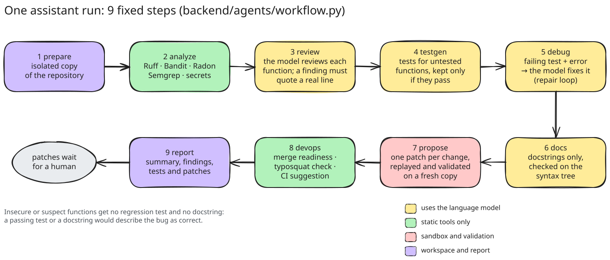

1. **Copy.** It works on a copy; your code is never touched during a run.
2. **Check with normal tools.** Ruff (style), Bandit and Semgrep (security), Radon (complexity), a
   secret scanner and a detector for hidden instructions aimed at AI tools. No AI here, so these
   findings are reliable.
3. **Review.** The model reads each function and says what looks wrong. It is often wrong, so its
   findings are kept apart from the tools' findings, and a finding must quote a line that exists.
4. **Write tests.** The model writes tests for functions that have none: unit tests for one
   function, integration tests for a function together with the code it calls, and API tests for
   each web endpoint. Each test runs in the sandbox. A test is kept only if it passes; if it fails,
   the function is reported as a possible bug.
5. **Fix.** If an existing test fails, the model proposes a fix, which is tested in the sandbox
   too, up to three attempts.
6. **Document and report.** It adds missing docstrings, checks whether the change is ready to merge
   (blockers, dependency typos, CI), and writes a report.

Every change becomes a **patch**, checked alone on a fresh copy: no test that passed may fail, no
new security finding, no secret in the added lines. You approve a patch by sending back its exact
fingerprint; if anything changed since, it is refused. Applied patches can be undone.

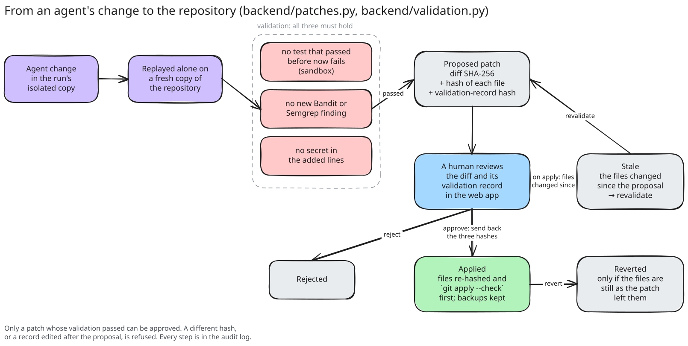

**The safety idea in one sentence:** the model only writes text, programs check that text, and a
person approves every change. A prompt-injection trick hidden in a repository therefore cannot make
it do anything.

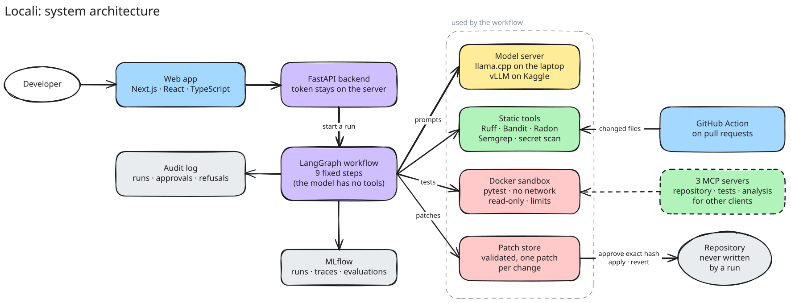

### The web app

| | |
|---|---|
| 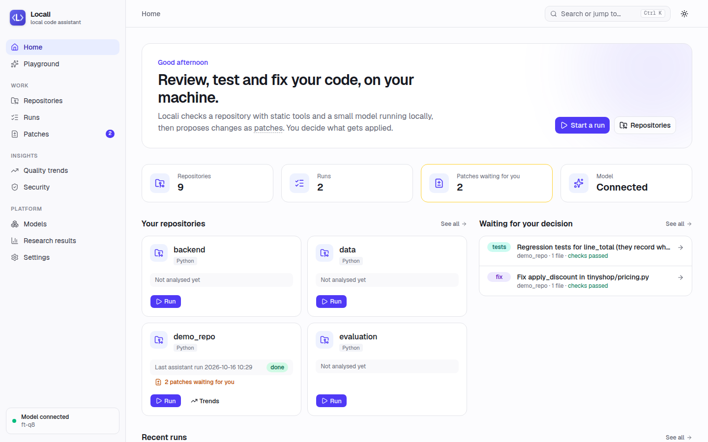 | 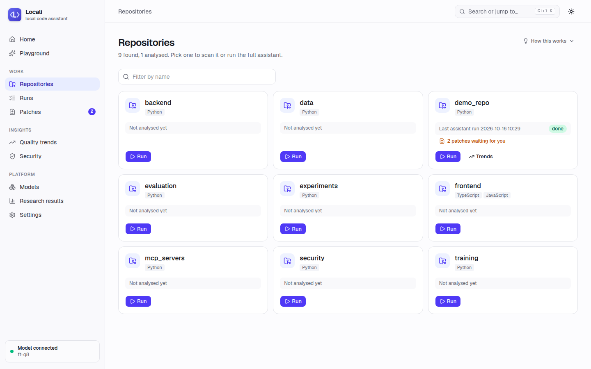 |
| **Home**: what to do next, changes waiting for a decision | **Repositories**: languages, last run, patches waiting |
| 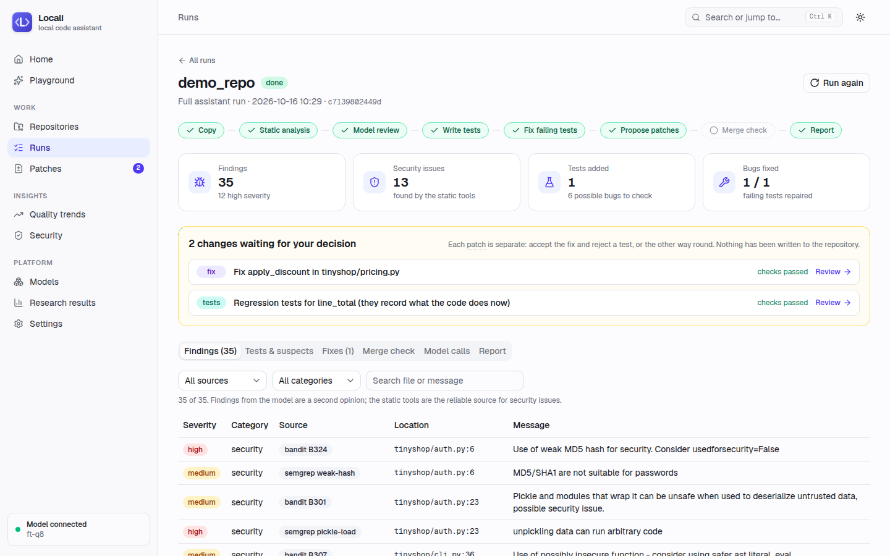 | 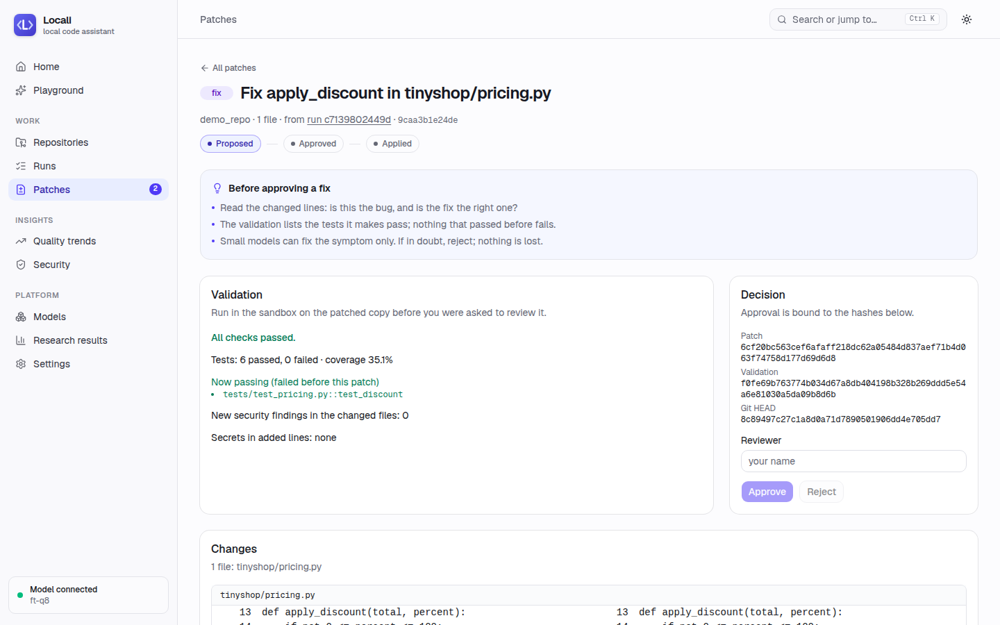 |
| **A run**: the steps, a summary, every finding, test, fix and model call | **Patch review**: what to check, the validation record, approve the exact patch |
| 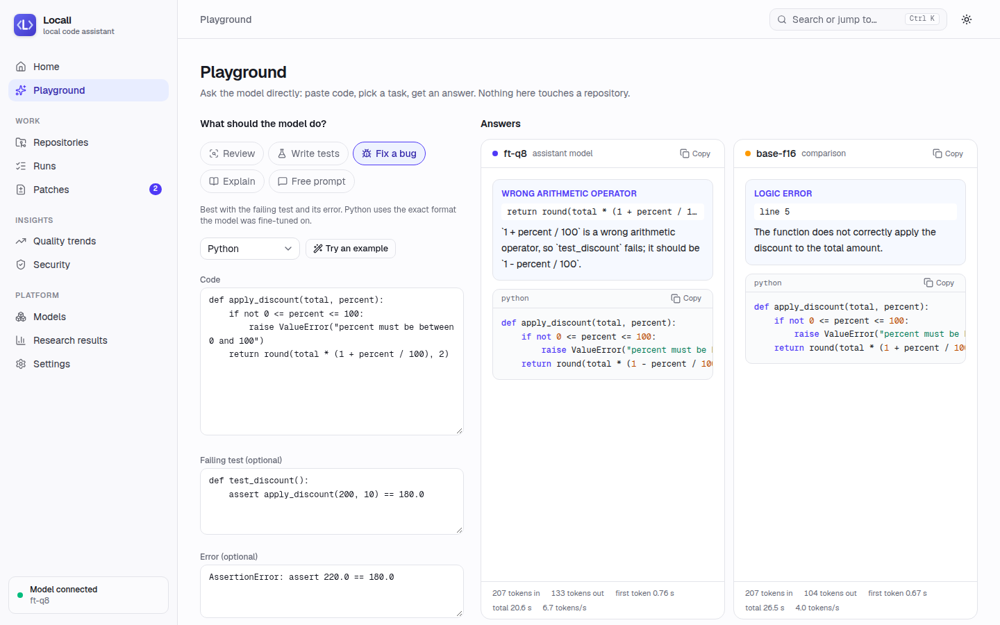 | 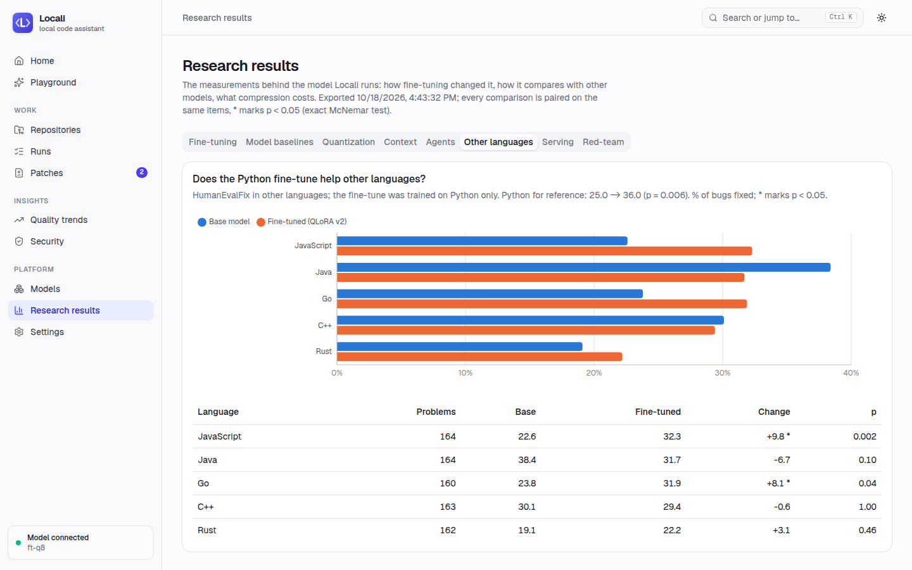 |
| **Playground**: two models side by side on code you paste | **Research results**: every study |

Dark theme: [home-dark.png](docs/screenshots/home-dark.png). Quick scans (tools only) work on
Python, JavaScript, TypeScript, Java and Go; the full assistant works on Python.

### Does it work? The demo project

`demo_repo/` is a small shop application I built with planted problems: 6 bugs, 5 security holes,
a hard-coded key, a misspelled dependency and two hidden instructions for AI tools
([answer key](security/demo_repo_flaws.json)).

| On the demo project (before its web API was added) | One review per file | Full workflow, no tools | Full workflow + tools |
|---|---|---|---|
| Bugs caught (of 5) | 0 | 3 | 4 |
| Bugs fixed | 0 | 1 | 1 |
| Security holes found (of 5) | 3 | 3 | 5 |
| Hard-coded key found | no | no | yes |
| Model calls | 8 | 40 | 40 |

The tools found every security hole and the key without a false alarm; the model alone found a
different 3 of 5 each time. With the web API added, a test the model wrote for the order endpoint
caught the sixth bug (an order larger than the stock was accepted), and the tests it kept raised
the share of code that tests run from 28 to 45 %
([results](experiments/results/7_assistant/agents_demo_repo/README.md),
[API tests](experiments/results/7_assistant/agents_api_tests/README.md)).

**The same check with each model.** Before changing the default model, I ran the whole assistant
on the demo project (with its web API) three times on the laptop, once with each model, same code
and settings ([results](experiments/results/7_assistant/agents_runE/README.md)):

| Whole assistant on the demo project | 3B base | Run D | **Run E** |
|---|---|---|---|
| Bugs: fixed / found by the review / suspected by a test / missed (of 6) | 1 / 1 / 1 / 3 | 1 / 3 / 2 / 0 | 1 / 3 / 1 / 1 |
| Review warnings that point at nothing planted | 9 | 18 | 17 |
| Security holes, key and hidden instructions found (of 8) | 8 | 8 | 8 |
| Tests kept, and share of code they run (before: 28 %) | 2, 60 % | 2, 45 % | **4, 72 %** |
| Time for the whole run | 34 min | 20 min | **19 min** |

The fine-tuned models name three times more planted problems in their review, but also raise
twice as many wrong warnings. The security results come from the tools, so they are the same for
every model. The base takes longest because it writes long test files (10,516 words against about
4,100). One run each: this shows how the models behave, it does not prove a difference.

This is one project I built myself, with bugs I placed; it shows how the workflow behaves, not how
accurate it is in general. The columns also differ in more than the number of agents: most of the
security findings come from the tools.

### Security

Each threat in the brief has a control and an attack case, run with the control on and off
([results](experiments/results/7_assistant/redteam/README.md)):

| Threat | Control | Attacks that worked: control on / off |
|---|---|---|
| Prompt injection | The model never acts; README and issue text never reach it; injection detector | model red-team: harm 0/11 |
| Jailbreak | Output only parsed into findings or checked code | 0/6 complied |
| Data leakage | Secrets removed in both directions | 0/2 / 2/2 |
| Unsafe commands | Allow-list of commands, sandbox | 0/3 / 3/3 |
| Too many permissions | Tool servers confined to the project, read-only | 0/2 / 2/2 |
| Supply chain | Project code runs only in the sandbox; misspelled-package check | 0/2 / 2/2 |
| Unsafe output | Every patch checked with Bandit, Semgrep and the secret scanner | 0/4 / 4/4 |
| Too much autonomy | Approval of the exact patch, stale check, undo | 0/3 / 3/3 |

These are my own attacks against my own controls, with no attacker adapting to them: they show the
controls work as built, not that they resist a determined attacker. The property that carries the
security is the design: the model has no tools and never acts. The attack cases found two real
gaps, both fixed with a test that reproduces them.

## 3. Teaching the model

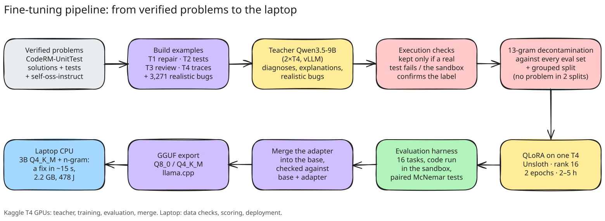

**The starting point.** I compared five free models on the benchmark tasks
([baselines](experiments/results/1_baselines/kaggle_reference_20261012/README.md)) and chose Qwen2.5-Coder:
cheap per correct answer and weakest exactly where Locali needs help (fixing bugs, writing tests),
so it had the most to gain.

**The lessons.** About 14,000 examples of "question → good answer" in four kinds, all built and
checked by running code, none written by hand:

| Kind | Question | Answer |
|---|---|---|
| Repair | Code with a bug + the failing test | The fixed code |
| Tests | A function | Tests for it |
| Review | A function + tool warnings | Bug or no bug, and why |
| Traces | A function + an input | What it returns |

To make repair examples, I took correct code, broke it on purpose and kept the example only if a
real test caught the break. A bigger model (Qwen3.5-9B, the "teacher") wrote the explanations.
Training one adapter takes about two hours on Kaggle's free GPU.

**What happened, step by step:**

1. **The 1.5B** learned to write tests (bugs caught 46 → 82 %) and to refactor (70 → 94 %), but
   only learned to fix the simple one-character bugs I had made
   ([results](experiments/results/2_finetune_1.5b/finetune_v2/README.md)).
2. **So I added realistic bugs**: the teacher wrote 3,271 bugs of seven kinds that people make (a
   forgotten line, an extra branch, an off-by-one), and I moved to a bigger base, the 3B
   ([bugs](experiments/results/3_finetune_3b/v3_bugs/README.md)).
3. **Runs A to E** tried variations of that data. **Run D** was the default model first
   ([run D](experiments/results/3_finetune_3b/finetune_qwen25_3b_qlora_mixv3b_diag/README.md)). **Run E** replaces
   part of the general data with the base model's own answers, so the model keeps more of its own
   way of writing code ([run E](experiments/results/3_finetune_3b/finetune_qwen25_3b_qlora_mixv3s/README.md)).
   Since 5 November, run E is the default.

**What it changed (3B base vs run D vs run E):**

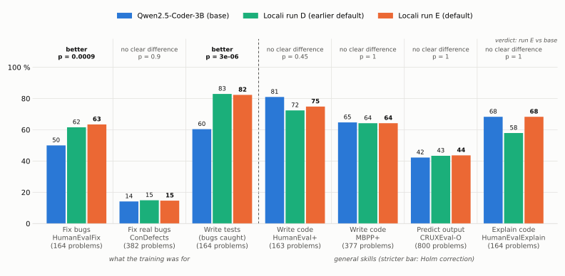

| % of problems | Problems | 3B base | Run D | **Run E** | Verdict, run E vs base | Verdict, run D vs base |
|---|---|---|---|---|---|---|
| Fix bugs (HumanEvalFix) | 164 | 50.0 | 61.6 | **63.4** | better, p = 0.0009 | better, p = 0.004 |
| Fix real bugs (ConDefects) | 382 | 14.1 | 14.9 | 14.7 | no clear difference, p = 0.90 | no clear difference, p = 0.79 (registered) |
| Write tests: bugs caught (2,048 tokens) | 164 | 60.4 | 82.9 | **82.3** | better, p = 3e-6 | better, p = 1e-6 |
| Write code (HumanEval+) | 163 | 81.0 | 72.4 | 74.8 | no clear difference after correction, p = 0.45 | no clear difference after correction, p = 0.088 |
| Write code (MBPP+) | 377 | 64.7 | 64.2 | 64.2 | no clear difference | no clear difference |
| Predict what code returns (CRUXEval-O) | 800 | 42.2 | 43.4 | 43.6 | no clear difference | no clear difference |
| Explain code (HumanEvalExplain) | 164 | 68.3 | 57.9 | 68.3 | same | no clear difference after correction, p = 0.061 |

The first three rows are what the training was for (each tested against its own small family);
the other four are general skills, held to a stricter bar because there are more of them (Holm's
correction, section 5).

Three things to read in this table:

- **The benchmark repair gain does not carry over to real bugs.** I chose the seven kinds of
  realistic bugs after reading the benchmark's results by bug type, so the model practised on bugs
  that look like the exam's. On 382 real bugs that people made on AtCoder in 2024, which nobody on
  my side designed, run D fixes 57 against the base's 54 (run E: 56). That is in the right
  direction but not significant, and the plausible gain is between −3 and +5 points, not 12
  ([real bugs](experiments/results/4_final_checks/repair_prereg_t4/README.md)).
- **The test-writing gain is about finishing.** The base model writes long test files and is cut
  off before the end in 97 of 164 answers, even with almost three times the room; often it repeats
  itself. Runs D and E write short, complete files. Where the base does finish, its tests catch the bug a
  little more often (93 vs 86 %) ([tests](experiments/results/4_final_checks/testgen2048_t4/README.md)).
- **Fine-tuning may cost some code writing.** Run D scores lower on HumanEval+ (81 → 72 %) and on
  explaining code (68 → 58 %), but neither drop passes the stricter bar. Run E loses less
  (81 → 75 %) and explains code as well as the base (68 %). The knowledge is still
  there: given 20 tries, run D solves as many HumanEval+ problems as the base
  ([why](experiments/results/3_finetune_3b/capability_study/)). Explaining code is scored by having the model
  rewrite the function from its own explanation, so it also needs code writing; when the base
  writes the code from run D's explanations instead, they score 65.9 against the base's 68.3, so
  the explanations themselves are about as good
  ([explanation](experiments/results/3_finetune_3b/explain_t4/README.md)).
- **A scoring mistake I found late, in the base's favour once fixed.** The benchmark prompt asks
  for the answer "in a markdown code block", and the base model sometimes took that literally: it
  labelled its code `markdown` instead of `python`, and my scorer skipped such blocks. Seven of
  its bug fixes were scored as failures for that reason, six of them correct. With the scorer
  fixed (code in a `markdown` block counts when it is valid Python), the base fixes 50.0 % instead
  of 46.3 %, and the gain shrinks from 15 to 12-13 points; it is still clearly significant. The
  fine-tuned models never answer this way, so their scores do not move. The same fix changes the
  base's refactoring score (86.5 → 89.0 %), one QuixBugs answer (20 → 21 of 40) and its real-bug
  score: 31 of its ConDefects answers were written this way and 7 were correct fixes, so the base
  fixes 54 real bugs, not 47. The real-bug conclusion is the same, the gap only smaller (run D: 57,
  p = 0.79 instead of 0.24).

### Run D or run E? The final check

D was the default only because it was ready first. Before switching to E, I compared the two
everywhere, including on the laptop with the 4-bit files people actually run:

| Test | Run D | Run E | Real difference? |
|---|---|---|---|
| Fix bugs, Kaggle GPU (16-bit) | 61.6 % | 63.4 % | no (p = 0.61) |
| Fix bugs, laptop (4-bit, all 164) | 100 | 95 | no (D alone 12, E alone 7, p = 0.36) |
| Explain code | 57.9 % | 68.3 % | **yes, E** (p = 0.019) |
| Spot vulnerabilities | 52.7 % | 54.5 % | **yes, E** (p = 0.024) |
| Write code (HumanEval+) | 72.4 % | 74.8 % | no |
| Fix real bugs (ConDefects) | 57 | 56 | no |
| Demo project: bugs found / caught by a test | 3 / 2 | 3 / 1 | one run |
| Demo project: tests kept, share of code they run | 2, 45 % | 4, 72 % | one run |

**What I read in it.** On fixing bugs they are tied: E is ahead on the GPU, D on the laptop, and
neither gap is bigger than luck. The only clear differences are on E's side: it explains code as
well as the base did, where D had lost ten points. So E is the default since 5 November.

Two caveats. I chose E after seeing these results, so its numbers are a little optimistic. And
4-bit rounding cost E a bit more than D (63.4 → 57.9 % against 61.6 → 61.0 %); with one run I
cannot tell whether that is luck. The real-bug check was registered on D, so that result stays a
run D result ([laptop](experiments/results/5_laptop/laptop_3b_energy_runE/README.md),
[demo project](experiments/results/7_assistant/agents_runE/README.md)).

**One bug, three answers.** A typical case where fine-tuning helps (HumanEvalFix `Python/133`,
the answers exactly as the models wrote them on Kaggle). The base hands the bug back unchanged;
both fine-tuned runs make the one-character fix:

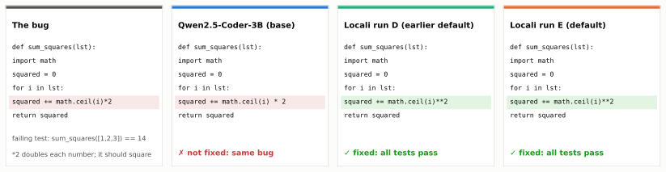

**The 1.5B, the fast option** ([results](experiments/results/2_finetune_1.5b/finetune_v2/README.md)):

| % of problems | 1.5B base | 1.5B fine-tuned | Verdict |
|---|---|---|---|
| Tests that catch the bug | 46 | 82 | better |
| Refactoring that keeps behaviour | 70 | 94 | better |
| Fix bugs, benchmark | 25 | 36 | better |
| Fix bugs, real bugs (ConDefects) | 8 | 6 | not better |
| Write code (MBPP+) | 56 | 62 | better |
| Write code (HumanEval+) | 65 | 62 | same |

I repeated its training with a second random seed: the repair and MBPP+ gains held, a gain in bug
detection did not, so I do not claim it
([second seed](experiments/results/2_finetune_1.5b/finetune_qwen25_qlora_v2_seed1234/README.md)).

<details>
<summary><b>More detail: the training recipe and every run</b></summary>

- Data: [mixture v2](experiments/results/2_finetune_1.5b/data_mix_v2/README.md) (14,151 examples), realistic bugs
  in [v3](experiments/results/3_finetune_3b/v3_bugs/README.md); examples that overlap the test benchmarks
  (13 words in a row) were removed.
- Training: Unsloth on one T4, adapter rank 16, two passes over the data; QLoRA, 16-bit LoRA and
  rsLoRA compared on the same data, same quality, QLoRA uses the least memory (3.1 GB).
- Phi-4-mini got worse from the same data: my answers were weaker than what it already wrote.
- 3B runs: [A](experiments/results/3_finetune_3b/finetune_qwen25_3b_qlora_mixv2/README.md),
  [B](experiments/results/3_finetune_3b/finetune_qwen25_3b_qlora_mixv3/README.md),
  [C](experiments/results/3_finetune_3b/finetune_qwen25_3b_qlora_mixv3b/README.md),
  [D](experiments/results/3_finetune_3b/finetune_qwen25_3b_qlora_mixv3b_diag/README.md),
  [E](experiments/results/3_finetune_3b/finetune_qwen25_3b_qlora_mixv3s/README.md). E (the default) replaces part of the general
  data with the base model's own answers; it loses less on code writing.
- Every base vs fine-tuned comparison, with the correction for testing many tasks:
  [tables](experiments/results/3_finetune_3b/multiple_comparisons/README.md).
- Why code writing drops, in four steps: [capability study](experiments/results/3_finetune_3b/capability_study/).

</details>

## 4. Running on a laptop

**Fewer digits per number (quantization).** Each of the model's numbers is normally stored with 16
bits. Rounding them to 8 or 4 bits is like saving a photo as a smaller JPEG: almost the same
picture, much less space ([results](experiments/results/5_laptop/ladder_laptop/README.md)).

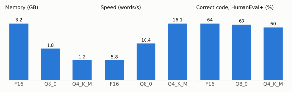

| Fine-tuned 1.5B on the laptop | 16-bit | 8-bit | 4-bit |
|---|---|---|---|
| Memory (GB) | 3.2 | 1.8 | 1.2 |
| Speed (words per second) | 5.8 | 10.4 | 16.1 |
| Correct code, HumanEval+ (%) | 64.4 | 63.2 | 60.1 |
| Energy per correct answer (J) | 638 | 396 | 234 |

8-bit changes 2 answers out of 163; 4-bit costs 2 to 4 points for almost three times the speed.
The default 3B (run E) runs in 4-bit: 1.9 GB on disk, 2.2 GB of memory, about 15 seconds per
problem and 478 J per fixed bug; run D needed 456 J because it fixed 5 more of the 164 bugs, a gap
within luck ([laptop check](experiments/results/5_laptop/laptop_3b_check/README.md),
[run E](experiments/results/5_laptop/laptop_3b_energy_runE/README.md)).

**Guessing ahead.** When fixing a bug, most of the answer copies the original code. The model
server guesses the next words from text already in the prompt and the model only checks the guess,
which is faster than writing (run D: 456 J per fixed bug instead of 501 J). A second small model doing
the guessing was slower here, because both share the same four processor cores
([results](experiments/results/5_laptop/speculative_3b_laptop/README.md)).

**Shorter prompts.** Giving the model only the function and the failing test, instead of the whole
file and every test, halves the input and fixes as many bugs
([results](experiments/results/2_finetune_1.5b/context_ablation_t4/README.md)).

**On a GPU, for comparison** ([results](experiments/results/6_gpu_serving/serving_t4/README.md)): answering 16
requests at once gives 13.6 times more answers per second and uses 15 times less energy per
answer; remembering what was already read (the KV cache) doubles the speed.

Energy is measured with the processor's built-in energy counter (RAPL) on the laptop and the GPU's
power reading (`nvidia-smi`) on Kaggle, per answer.

## 5. How I measured

**Exams with an answer key.** Each skill has a benchmark: a fixed list of problems with tests that
decide whether an answer is right. Eleven of them: writing code (HumanEval+, MBPP+), completing
code, fixing bugs (HumanEvalFix), detecting bugs, explaining code, predicting what code returns
(CRUXEval-O), writing tests, refactoring, writing secure code and spotting vulnerabilities. Plus two
sets of real bugs added for the final check: ConDefects and QuixBugs.

**"Bugs caught" by the tests a model writes.** Each generated test first runs on the correct code
and is dropped if it fails there (a wrong expected value). The bug counts as caught if at least one
remaining test fails, errors or hangs on the buggy code, with the same 60 s limit on both. A
problem where no test survives catches nothing.

**Answers run in the sandbox.** Model answers are code, so they only run in the sandbox. Before
scoring any model, I gave every benchmark its official correct answers: all scored 100 %, so the
scoring itself works ([harness check](experiments/results/1_baselines/harness_validation/README.md)). Kaggle's
GPUs write the answers; the laptop scores them.

**Is a difference real or luck?** Base and fine-tuned models answer the same problems. I count the
problems where they disagree: say the base alone is right on 11 and the fine-tuned model alone on
36. If fine-tuning changed nothing, those two counts would be about equal, like coin flips. The
exact McNemar test gives the chance of a split at least that uneven by luck (the p-value).

**Many tests at once.** With eleven tasks, one can look significant by luck. Fixing bugs and
writing tests are the two claims (the training was built for them); every other task is
exploratory and gets a stricter bar (Holm's correction)
([tables](experiments/results/3_finetune_3b/multiple_comparisons/README.md)).

**Rules written before the test.** For the two final checks (real bugs, test files with more
room), I wrote down the benchmarks, models, prompt, statistical test and the sentence I would write
for each outcome, and committed that file before running anything
([protocol](docs/preregistration-repair.md), commit 15aa6b9). The real-bug result went against me,
and this report says so in the words fixed in advance.

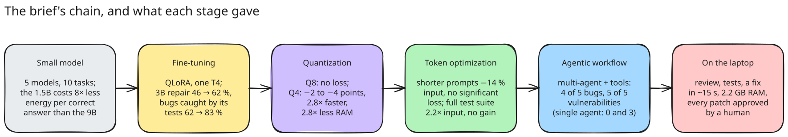

## 6. What did not work, and limits

- **The repair gain is mostly on bugs like my training data.** On real bugs, 54 → 57 of 382, not
  significant (section 3).
- **The model is a noisy reviewer.** On the demo project most of its review findings are wrong;
  base models answer "yes, there is a bug" to almost everything. Model findings are kept apart from
  tool findings and never become changes on their own.
- **Spotting vulnerabilities stayed at chance** (about 50 %) for every model.
- **Phi-4-mini got worse** from my data; 500 verified "no bug" reviews did not reduce false alarms.
- **The 9B comparison is weak.** The 1.5B fixes 36 % of the benchmark bugs and the 9B 66 %, but the
  9B also wrote my training bugs and explanations, so the fine-tuned 3B's 63 % is a student nearing
  its teacher on the teacher's kind of bugs.
- **Kaggle and the laptop do not decode exactly alike** (Kaggle's server applied the model's default
  repetition penalty); comparisons always use the same setup for both models.
- **Single runs.** Most settings ran once; the paired tests are what make differences meaningful.
- **The demo project and the attack cases are mine.** They show behaviour, not general accuracy.
- **Other languages.** The fine-tune was trained on Python; on repair in other languages it gains
  in JavaScript and Go, is level in C++ and Rust, lower in Java
  ([results](experiments/results/2_finetune_1.5b/multilang_t4/README.md)).
- **Dense vs hybrid attention** is answered only by computed memory sizes, not measured.

## 7. The brief, point by point

| The brief asks | Where |
|---|---|
| Benchmark small models on generation, completion, bug detection, explanation, refactoring, tests | section 5, `evaluation/` |
| Fine-tune with LoRA / QLoRA (Unsloth) | section 3, `training/` |
| 4/8-bit quantization; KV cache, batching, attention | section 4 |
| Context compression, prompt optimization | section 4, [context](experiments/results/7_assistant/context_agents/README.md) |
| Latency, throughput, memory, energy | section 4, every result folder |
| Static analysis, code quality, vulnerabilities | section 2, `backend/analysis.py` |
| Unit, integration and API tests, coverage, regression tests | section 2, `backend/agents/` |
| LangGraph agents: analysis, tests, debugging, documentation, review, DevOps | section 2, `backend/agents/workflow.py` |
| MCP tool access: repository, tests, analysis, documentation, issues | `mcp_servers/` (five servers, read-only except a sandboxed test runner and issue drafts outside the project) |
| Git, CI/CD, pull-request review | `.github/workflows/` |
| LLMOps: model versions, prompts, data, tokens, agent traces | MLflow, `backend/llmops.py` |
| React/TypeScript web app + FastAPI | section 2, `frontend/`, `backend/` |
| LLM security threats with attack tests | section 2 |
| Five ablations | below |

**The five ablations of the brief:**

| Comparison | Result |
|---|---|
| Base vs fine-tuned | tests and refactoring much better; benchmark repair better, real-bug repair not proven; code writing a bit lower (section 3) |
| 16-bit vs 8-bit vs 4-bit | 8-bit the same, 4-bit −2 to −4 points for 2.8× the speed and 2.8× less memory |
| Standard vs optimized prompt | compressed prompt: −14 % input, −2.4 points (not significant) |
| Full vs reduced context | the full test suite doubles the input for no gain; a whole file instead of one function misses a bug |
| Single vs multi-agent | 0 vs 4 bugs caught on the demo project, mostly thanks to the tools |

Every requirement mapped to its code and evidence: [docs/spec-checklist.md](docs/spec-checklist.md).

## 8. Running it

Requirements: Python 3.12 with [uv](https://docs.astral.sh/uv/), Docker, Node 22, and
[llama.cpp](https://github.com/ggml-org/llama.cpp) for the model server.

```bash
uv sync
uv run python -c "from security.sandbox import ensure_image; ensure_image()"   # test sandbox
(cd frontend && npm ci)
cp .env.example .env    # then set the token, the keys and the path to the GGUF model
# the default model (1.93 GB, Qwen research licence, non-commercial):
uv run hf download MedGm/Llama-Locali-Qwen2.5-Coder-3B-GGUF llama-locali-qwen2.5-coder-3b-run-e-q4_k_m.gguf --local-dir models
```

Then, one per terminal:

```bash
scripts/run.sh model      # the fine-tuned 3B (Q4_K_M) with llama.cpp and n-gram lookup
scripts/run.sh compare    # optional: a second model for the playground
scripts/run.sh backend    # the API
scripts/run.sh web        # http://localhost:3000
```

The backend, the web app and the model servers all read the one `.env`
([.env.example](.env.example) explains each line). Without a model server, quick scans still work.

## 9. Reproducing the results

Every result folder in `experiments/results/` holds the model answers (`samples.jsonl`), the scores,
the settings with exact model versions, the commit it ran at and a README saying how it was made.
`bash experiments/scripts/report/reproduce.sh` rebuilds every derived table and chart from a clean checkout
and reruns the attack cases ([details](experiments/results/REPRODUCTION.md)). The charts in this
report come from `experiments/scripts/report/report_figures.py`, the diagrams from
`docs/diagrams/make_diagrams.py`. Kaggle jobs are in `training/kaggle/` and check out the exact
commit they were built from.

## 10. Use of AI tools

I used Claude Code (Anthropic's coding assistant) throughout the project. It wrote most of the
code, tests, experiment scripts and first drafts of the result write-ups, at my request and under
my review. The research questions, the choice of models and methods, the decisions after each
result and the scope were mine; every number in this report comes from a run whose answers and
logs are committed. Claims in drafts were checked against the data, and the harness was validated
on correct answers before any model was scored. The models inside Locali are unrelated to this:
they are the fine-tuned Qwen2.5-Coder models described above.

## 11. Where things are

| Folder | What it holds |
|---|---|
| `backend/` | The assistant: web API, the workflow steps (`backend/agents/`), patches, validation |
| `frontend/` | The web app |
| `security/` | Sandbox, command allow-list, secret scanner, injection detector, the demo project's answer key |
| `mcp_servers/` | Five tool servers other AI clients can use: repository, tests, analysis, documentation, issues |
| `demo_repo/` | The shop application with planted problems |
| `training/` | Building the training data (`training/data/`) and the jobs sent to Kaggle (`training/kaggle/`: `make_data`, `train`, `deploy`, `evaluate`) |
| `evaluation/` | The benchmarks (`evaluation/tasks/`), scoring, energy measurement |
| `experiments/results/` | Every result with its README, in seven groups in the order of the project: `1_baselines`, `2_finetune_1.5b`, `3_finetune_3b`, `4_final_checks`, `5_laptop`, `6_gpu_serving`, `7_assistant`, plus `archive` |
| `experiments/scripts/` | The scripts that made the charts and tables (`report/`), the statistics (`stats/`), the assistant runs (`assistant/`) and the laptop runs (`laptop/`) |
| `docs/` | Diagrams, charts, screenshots, the requirement checklist, the pre-registration; my planning notes (`docs/notes/`) and the Hugging Face and Kaggle cards (`docs/publish/`) |
| `paper/` | A short paper on energy per correct answer |

`experiments/results/` holds about 2,400 of the repository's 2,800 files: the raw answers behind
every number, kept as evidence. Its [index](experiments/results/README.md) has one line per
folder; the [scripts](experiments/scripts/README.md) and [Kaggle jobs](training/kaggle/README.md)
have one too.

Planning and status: [ROADMAP.md](ROADMAP.md).
