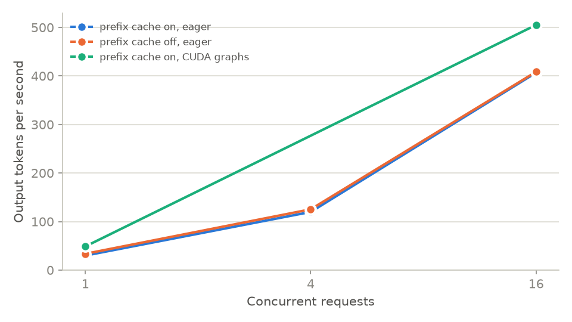
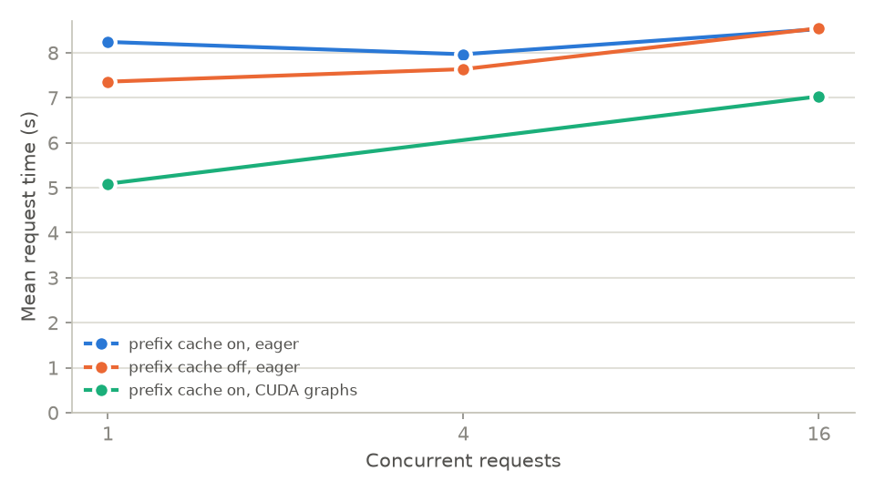

# Serving efficiency on a T4 (C4): KV cache, batching, attention

Run on 2026-10-17 in a Kaggle notebook with 2 × T4 (`training/kaggle/serving/kaggle_serving.py`,
commit `bca6e71`), the merged QLoRA v2 model from the Hub
(`MedGm/Llama-Locali-Qwen2.5-Coder-1.5B@a1b0b11`), FP16, greedy. Workload: the first 64 held-out
repair problems (`internal_t1`), answers scored afterwards in the local sandbox. Tables and plots
come from `experiments/scripts/serving_table.py`; the full tables are in [tables.md](tables.md).

## vLLM 0.29.0 (GPU 0)

Each row is a fresh server, so one run's cache never helps another, except the warm pass, which is
the same 64 prompts sent again to the server that has just answered them.

| Server | Concurrent requests | Throughput | Mean TTFT | Mean request time | GPU energy per item | pass@1 |
|---|---|---|---|---|---|---|
| prefix cache on, eager | 1 | 29.9 tok/s | 0.100 s | 8.24 s | 551 J | 71.9 |
| prefix cache on, eager | 4 | 119.8 tok/s | 0.177 s | 7.97 s | 138 J | 70.3 |
| prefix cache on, eager | 16 | 406.7 tok/s | 0.379 s | 8.53 s | 37 J | 71.9 |
| same, warm second pass | 16 | 440.5 tok/s | 0.182 s | 7.80 s | 37 J | 71.9 |
| prefix cache off, eager | 1 | 33.5 tok/s | 0.086 s | 7.36 s | 493 J | 70.3 |
| prefix cache off, eager | 4 | 125.2 tok/s | 0.135 s | 7.64 s | 131 J | 70.3 |
| prefix cache off, eager | 16 | 408.5 tok/s | 0.404 s | 8.55 s | 39 J | 71.9 |
| prefix cache on, CUDA graphs | 1 | 48.7 tok/s | 0.127 s | 5.09 s | 336 J | 71.9 |
| prefix cache on, CUDA graphs | 16 | 505.1 tok/s | 0.389 s | 7.03 s | 31 J | 71.9 |

(CUDA graphs were measured at 1 and 16 concurrent requests only; the line between them is not a
measurement.)

- **Batching is what matters.** 16 concurrent requests give 13.6 times the throughput of one at a
  time and use 15 times less GPU energy per answer, while each request takes about as long. A
  request mostly waits on its own decoding, and the GPU has room for many of them at once. This is
  why every T4 evaluation in this project sent 16 requests at a time.
- **CUDA graphs are free speed I had left on the table.** Every earlier T4 run used
  `--enforce-eager`. Graphs make a single request 1.6 times faster (48.7 vs 29.9 tok/s) and 16
  concurrent requests 24 % faster, with the same pass@1. The earlier measurements are still valid
  comparisons among themselves, since they all used the same setting, but their absolute times are
  pessimistic.
- **Prefix caching changes nothing on this workload.** On and off are within run-to-run noise
  (407 vs 409 tok/s at 16). The repair prompts share only a short instruction prefix; the rest is
  each problem's own code and test. A warm cache halves time to first token (0.38 → 0.18 s) when
  the same prompts come back, as when a stale patch is revalidated, but answers take seconds to
  generate, so the total barely moves (39 → 36 s for all 64).
- **Answers stay the same, not identical.** pass@1 is 70.3 or 71.9 (45 or 46 of 64) in every
  configuration. Between configurations 2 to 6 of the 64 answers differ in wording: greedy decoding
  on a GPU is not bit-exact when batch shapes or kernels change. The one-item swings in pass@1 come
  from those.

## transformers 5.16.1 (GPU 1), 16 prompts

| Run | Batch | KV cache | Tokens/s | Peak memory | Usable answers |
|---|---|---|---|---|---|
| SDPA attention | 1 | on | 23.5 | 3.16 GB | 16/16 |
| SDPA attention | 8 | on | 162.9 | 3.47 GB | 16/16 (14 identical to batch 1) |
| SDPA attention, 128 new tokens, 4 prompts | 1 | on | 23.1 | 3.14 GB | 4/4 |
| same, KV cache off | 1 | off | 11.1 | 3.15 GB | 4/4 (identical to cache on) |
| eager attention | 1 | on | 25.1 | 3.15 GB | **0/16** |
| eager attention | 8 | on | 183.2 | 3.52 GB | **0/16** |

- **The KV cache halves generation time already at 128 tokens** (11.1 → 23.1 tok/s) with
  identical answers. Without it every new token recomputes attention over the whole prompt and
  answer so far, so the gap grows with the answer length; repair answers average about 240 tokens.
- **Batch 8 is 6.9 times faster than batch 1** for 10 % more memory.
- **Eager attention in FP16 does not work for this model on a T4.** Every eager answer is `!!!!…`
  to the token limit: the attention scores overflow FP16, the logits become NaN, and generation
  keeps emitting token 0. Its tokens per second are therefore not comparable with SDPA, which
  computes the same attention in a numerically safer way. I did not rerun eager in FP32; the point
  for deployment is that the default (SDPA) is the one that works.
- For one request at a time, transformers is 1.3 times slower than vLLM in eager mode (23.5 vs
  29.9 tok/s) and 2.1 times slower than vLLM with CUDA graphs (48.7 tok/s).

## Limits

One run per configuration, 64 items for vLLM and 16 for transformers. Run-to-run noise is visible
(prefix cache off at 1 request was faster than on, which has no mechanism behind it), so
differences under about 10 % here are not findings. GPU energy is board power from `nvidia-smi`,
integrated over each run's wall time.
